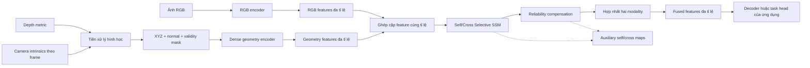

# Hệ thống bù trừ RGB–D bằng hình học metric và Selective SSM

Tài liệu này mô tả toàn bộ phần hệ thống đang được hiện thực trong repository. Nội dung tập trung vào **vai trò, luồng dữ liệu, quan hệ giữa các module và hợp đồng vào/ra**; không khóa kiến trúc vào độ phân giải, số kênh, độ rộng trạng thái, ngưỡng xử lý hay số liệu benchmark cụ thể. Các giá trị đó là cấu hình của từng thí nghiệm và mã nguồn là nơi quyết định cuối cùng.

## 1. Mục tiêu và phạm vi

Hệ thống nhận hai nguồn thông tin đã đăng ký không gian với nhau:

- ảnh RGB, cung cấp ngữ nghĩa và cấu trúc thị giác;
- depth metric cùng ma trận nội tại camera của từng frame, cung cấp vị trí và hình học bề mặt trong hệ tọa độ camera.

Hai nguồn được mã hóa độc lập thành các feature map đa tỉ lệ. Tại mỗi tỉ lệ, một khối bù trừ chéo dùng Selective State Space Model (Selective SSM) để tạo biểu diễn nội modality và biểu diễn đã nhận thông tin từ modality còn lại. Reliability gate học cách nội suy giữa hai biểu diễn này trước khi hợp nhất chúng thành feature đầu ra.

Phần lõi của repository là **thư viện feature extraction và feature fusion**. Pipeline keypoint bổ sung trong `models/keypoints/` nối chính các module này với decoder heatmap, dataset loader, loss, trainer, evaluator và inference CLI; xem mục 18. Các mục 2–17 dưới đây mô tả hợp đồng của phần lõi. Với tác vụ khác, ứng dụng chủ nối feature đã hợp nhất vào head phù hợp.

## 2. Kiến trúc tổng thể



Ký hiệu dùng trong tài liệu:

- `B`: kích thước batch;
- `C`: số kênh tại một tầng;
- `H, W`: kích thước không gian của feature map;
- `L = H × W`: chiều dài chuỗi sau khi trải phẳng không gian;
- `R_i`, `G_i`, `F_i`: feature RGB, geometry và fused tại cùng tỉ lệ `i`.

Các kích thước trên là ký hiệu động. Hệ thống không giả định một độ phân giải ảnh hoặc một độ rộng feature duy nhất.

## 3. Hợp đồng dữ liệu đầu vào

### 3.1. RGB

RGB có layout `NCHW`, là tensor số thực và được đưa qua `SEResNetBackbone`. Wrapper chỉ trả về feature; nó không sở hữu task head. Các tầng cần xuất được chọn khi khởi tạo backbone.

### 3.2. Depth metric

Depth biểu diễn tọa độ `Z` theo trục quang học của camera bằng đơn vị metric. Depth không phải ảnh visualization, disparity hoặc depth đã min-max normalize. Một điểm hợp lệ phải hữu hạn và có độ sâu dương.

### 3.3. Camera intrinsics

Mỗi frame phải có ma trận nội tại `K` tương ứng với đúng lưới pixel hiện tại. Hệ thống kiểm tra mô hình pinhole không skew, focal length hợp lệ và hàng cuối đúng quy ước camera.

Nếu RGB/depth được crop hoặc resize, ứng dụng chủ phải áp dụng phép biến đổi không gian nhất quán cho cả hai và cập nhật `K`. Việc hai tensor có cùng `H, W` chỉ chứng minh chúng có cùng kích thước, không chứng minh chúng đã đăng ký vật lý.

### 3.4. Loader frame có sẵn

`models/geometry/io.py` cung cấp `load_depth_frame` để đọc depth sensor và `K` theo frame từ cấu trúc dữ liệu quy ước của dự án. Loader:

- chỉ đọc depth sensor metric và camera intrinsics;
- không đọc ảnh depth dùng để hiển thị;
- không tự đổi đơn vị, lấp lỗ, nội suy hoặc resize;
- trả từng frame để phía gọi tự ghép batch.

## 4. Nhánh RGB

`models/geometry/se_resnet.py` bọc họ SE-ResNet của `timm` ở chế độ `features_only`. Backbone tạo một tuple feature đa tỉ lệ theo thứ tự lan truyền từ tầng nông đến tầng sâu.

Nhánh RGB độc lập với nhánh geometry. Hai encoder không chia sẻ trọng số và geometry không được tạo bằng cách sao chép một SE-ResNet thứ hai. Những thông tin mà khối fusion cần từ RGB encoder là:

- danh sách feature được chọn;
- số kênh của từng feature;
- hệ số giảm kích thước không gian của từng tầng.

Metadata này được dùng để dựng nhánh geometry tương thích và cấu hình các khối fusion, thay vì hard-code theo một biến thể backbone.

## 5. Nhánh hình học metric

Nhánh này gồm hai phần: biến đổi hình học xác định và encoder học được.

### 5.1. Mask depth hợp lệ

`build_valid_mask` đánh dấu pixel có depth hữu hạn và dương. Giá trị depth lỗi như `NaN`, vô cực, bằng không hoặc âm không được truyền thẳng vào phép chiếu ngược. Các giá trị hình học không hợp lệ được đưa về không để tránh làm nhiễm `NaN/Inf` vào mạng tích chập.

### 5.2. Chiếu ngược depth thành XYZ

`depth_to_xyz` dùng mô hình pinhole và `K` riêng của từng frame:

```text
X = (u - cx) Z / fx
Y = (v - cy) Z / fy
Z = depth(u, v)
```

Hệ tọa độ được quy ước: `X` hướng sang phải, `Y` hướng xuống dưới và `Z` hướng ra phía trước camera. Tọa độ pixel dùng tâm tại chỉ số nguyên. Pixel depth không hợp lệ sinh vector XYZ bằng không.

Phép toán hình học được thực hiện với độ chính xác đủ an toàn khi đầu vào đang ở mixed precision. Nếu biên độ depth hoặc `K` làm kết quả tràn số, module báo lỗi thay vì âm thầm trả tensor hỏng.

### 5.3. Ước lượng pháp tuyến bề mặt

`xyz_to_normals` ước lượng hai tiếp tuyến cục bộ từ các điểm lân cận theo phương ngang và dọc, sau đó lấy tích có hướng:

```text
dx = P_phải - P_trái
dy = P_dưới - P_trên
normal = normalize(dx × dy)
```

Normal tại một pixel chỉ hợp lệ khi tâm và các lân cận cần thiết đều hợp lệ, chênh lệch depth không vượt quy tắc gián đoạn, tích có hướng không suy biến và mọi giá trị vẫn hữu hạn. Border, lỗ depth và vùng đứt gãy bề mặt vì vậy không tạo normal giả. Normal không xác định được gán bằng không.

Hướng normal được sửa theo tia nhìn camera để nhất quán trên toàn frame. Hướng quy ước có thể đảo qua tùy chọn của module, nhưng phải được giữ nhất quán giữa huấn luyện và suy luận.

### 5.4. Tensor hình học đầu vào

`build_geometry_tensor` ghép theo chiều kênh:

```text
geometry = concat(XYZ, surface_normal, depth_valid_mask)
```

Mask trong tensor trên biểu diễn tính hợp lệ của depth. Tính hợp lệ của normal nghiêm ngặt hơn: một pixel có thể vẫn giữ XYZ và mask hợp lệ nhưng normal bằng không do thiếu lân cận tốt.

Không có RGB normalization, chuẩn hóa XYZ theo từng ảnh, point sampling, hole filling hay prior ẩn nào được áp dụng ở bước này. Khoảng cách metric được giữ nguyên để encoder có thể học từ hình học tuyệt đối.

### 5.5. Dense geometry encoder

`DenseGeometryEncoder` nhận tensor geometry và tạo tuple feature `G_i`. Encoder gồm stem tích chập, phép giảm mẫu và các residual block học được. Mỗi residual block có:

- nhánh chính dùng các phép tích chập, chuẩn hóa theo nhóm và activation;
- nhánh tắt identity khi shape cho phép, hoặc projection khi cần đổi kênh/stride;
- phép cộng residual và activation đầu ra.

Lịch giảm mẫu được thiết kế để feature geometry có cùng lưới không gian với feature RGB tương ứng, kể cả khi kích thước đầu vào lẻ. Không có phép resize bí mật để che sai lệch. `DenseGeometryEncoder.from_rgb_backbone` đọc các tầng đã chọn từ RGB backbone và từ chối cấu hình có reduction không tương thích.

`DepthGeometryBranch` là wrapper nối toàn bộ chuỗi:

```text
depth + K → validity → XYZ → normal → geometry tensor → geometry encoder
```

## 6. Selective State Space Model nền tảng

### 6.1. Biểu diễn chuỗi

Feature ảnh `[B,C,H,W]` được chuyển thành chuỗi `[B,C,L]`. Chế độ raster đọc theo hàng. Chế độ không gian đa hướng tạo các thứ tự quét theo hàng, theo cột và các hướng đảo; cùng một bộ trọng số được dùng cho các hướng và kết quả sau khi hoàn nguyên được lấy trung bình.

`scan_image` và `merge_image` chịu trách nhiệm duy nhất cho việc đổi thứ tự không gian. Cả RGB và geometry luôn dùng cùng phép sắp thứ tự nên token ở hai modality vẫn tương ứng.

### 6.2. Tham số chọn lọc và recurrence

`SimpleSelectiveSSM` sinh từ từng chuỗi các tham số phụ thuộc token:

- `Delta`: bước chuyển trạng thái dương;
- `B`: cách input ghi vào trạng thái;
- `C`: cách trạng thái được đọc ra output.

Module đồng thời sở hữu `A`, mô tả động lực trạng thái, và `D`, đường truyền trực tiếp từ input tới output. Với từng token, recurrence có dạng:

```text
state_t = exp(Delta_t · A) · state_(t-1)
          + Delta_t · B_t · input_t

output_t = C_t · state_t + D · input_t
```

Đây là selective scan thực với trạng thái tuần tự, không phải attention giả lập. `SimpleSelectiveSSM` không biết modality còn lại; tương tác chéo được tổ chức ở lớp CP-SSM.

### 6.3. Backend thực thi

Hệ thống có hai backend được chọn rõ ràng:

- backend PyTorch thuần là bản tham chiếu đúng đắn, chạy được trên CPU và hỗ trợ autograd nhưng quét tuần tự nên không phù hợp cho feature lớn khi huấn luyện;
- backend Mamba gọi selective-scan kernel tăng tốc và yêu cầu môi trường CUDA cùng extension tương ứng.

Không có cơ chế âm thầm đổi backend khi dependency thiếu. Cấu hình sai phải lỗi sớm để tránh benchmark hoặc huấn luyện bằng một đường thực thi ngoài dự kiến.

## 7. Cross-Parametric SSM

### 7.1. Chuẩn bị feature

Tại một tỉ lệ, `RGBDCompensation` trước hết project feature RGB và geometry về cùng không gian kênh. `CrossParametricSSM` tiếp tục:

1. tạo embedding riêng cho từng modality;
2. trộn ngữ cảnh cục bộ bằng depthwise convolution dùng chung;
3. trải feature thành chuỗi theo cùng thứ tự không gian;
4. sinh bộ tham số selective SSM riêng cho RGB và geometry.

### 7.2. Nhánh self

Nhánh self chạy mỗi chuỗi bằng toàn bộ tham số do chính chuỗi đó sinh ra:

```text
RGB self:      scan(R; Delta_R, A_R, B_R, C_R, D_R)
Geometry self: scan(G; Delta_G, A_G, B_G, C_G, D_G)
```

Kết quả thể hiện ngữ cảnh dài hạn nội tại của từng modality.

### 7.3. Nhánh cross

`CPSSM` chỉ trao đổi tham số đọc trạng thái `C` giữa hai modality:

```text
RGB cross:      scan(R; Delta_R, A_R, B_R, C_G, D_R)
Geometry cross: scan(G; Delta_G, A_G, B_G, C_R, D_G)
```

Modality nhận vẫn giữ input, động lực trạng thái, bước thời gian, cách ghi trạng thái và đường skip của mình; modality cho chỉ quyết định cách trạng thái đó được đọc. Vì vậy cross feature là feature của **recipient được diễn giải bằng readout của donor**, không phải phép cộng hoặc hoán đổi toàn bộ feature.

Self và cross của cùng một recipient tái sử dụng đúng bộ tham số đã sinh từ token, cùng normalization và cùng output projection. Thiết kế này làm cho sai khác `cross - self` phản ánh tác động của trao đổi `C`, không bị lẫn với một output head khác.

Sau scan, chuỗi được normalize, hoàn nguyên về feature map và project về không gian kênh fusion. `CrossParametricSSM` trả:

- `rgb_self`;
- `rgb_cross`;
- `depth_self`;
- `depth_cross`.

Tên `depth` trong các khóa fusion được giữ để tương thích API; khi dùng `DepthGeometryBranch`, nó thực chất là feature geometry đã học từ depth metric.

## 8. Reliability compensation

`ResidualCompensation` dùng hai gate độc lập cho hai hướng truyền thông tin. Mỗi `ReliabilityGate` quan sát:

```text
concat(self_feature, cross_feature, abs(cross_feature - self_feature))
```

Sau các projection học được và sigmoid, gate có cùng shape với feature. Feature bù trừ được tính bằng:

```text
compensated = self + gate · (cross - self)
```

Ý nghĩa biên của công thức rõ ràng:

- gate tiến về không: giữ feature self;
- gate tiến về một: dùng feature cross;
- giá trị trung gian: nội suy theo từng batch, kênh và vị trí không gian.

`gate_d2r` điều khiển lượng thông tin geometry/depth đi vào nhánh RGB; `gate_r2d` điều khiển chiều ngược lại. Hai gate không chia sẻ trọng số. Chúng là trọng số học được từ feature, chưa phải xác suất độ tin cậy đã được calibration thống kê.

Hai feature đã bù trừ được concat, project, chuẩn hóa theo kênh tại từng pixel và qua activation để tạo fused feature của tỉ lệ hiện tại.

`RGBDCompensation.forward` trả một cặp:

```text
fused_feature, auxiliary_features
```

`auxiliary_features` chứa bốn feature self/cross, hai gate và hai feature đã bù trừ. Các tensor này vẫn giữ autograd graph; cần `detach()` trước khi lưu lâu dài hoặc trực quan hóa ngoài quá trình tối ưu.

## 9. Fusion đa tỉ lệ

`MultiScaleRGBDCompensation` tạo một `RGBDCompensation` độc lập cho mỗi cặp `(R_i, G_i)`. Các block ở các tỉ lệ không chia sẻ SSM, gate hay projection. Điều này cho phép mỗi tầng học kiểu tương tác phù hợp với receptive field và mức ngữ nghĩa của chính nó.

Tại từng tỉ lệ, hệ thống bắt buộc:

- batch và kích thước không gian giữa hai modality phải trùng nhau;
- số kênh phải đúng với cấu hình của block;
- dtype và device phải tương thích;
- tensor phải là số thực và không rỗng.

Đầu ra là một tuple fused feature đa tỉ lệ và một tuple dictionary phụ trợ tương ứng. Thứ tự đầu ra giữ nguyên thứ tự feature của hai encoder để decoder của ứng dụng có thể nối theo tầng.

## 10. Nhánh CP + SP dùng để đối chiếu MS2Fusion

`models/fusion/ms2fusion/branches.py` cung cấp `MS2FusionBranches`. Đây là đường xử lý riêng dùng để tái hiện phần CP/SP đã được đối chiếu với source MS2Fusion; nó **không phải** chính `RGBDCompensation` và cũng không tự động được gọi trong luồng reliability compensation.

### 10.1. CP path

CP path dùng `CPSSM` như mô tả ở trên: hai modality có parameterizer riêng và chỉ trao đổi `C`. Nó trả `rgb_cross` và `depth_cross`.

### 10.2. SP path

SP path tạo embedding shared cho từng modality bằng cùng projection, sau đó cộng hai embedding để sinh một bộ tham số selective SSM chung. Hai phép scan vẫn nhận input RGB và geometry riêng biệt, nhưng dùng chung `Delta`, `A`, `B`, `C` và `D`. Output normalization/projection của hai shared branch cũng dùng chung trọng số.

SP path trả `rgb_shared` và `depth_shared`. Nó không scan một tensor trộn duy nhất rồi sao chép output cho hai modality.

### 10.3. Phạm vi của block

`MS2FusionBranches` trả bốn feature `cross/shared`. Block không chứa residual wrapper, chuỗi CMSSF hoặc mạng SSF đầy đủ của upstream. Nó cũng không tự ghép SP vào công thức reliability của hệ thống chính.

Khi dùng nhánh CP+SP trực tiếp, `GeometryProjector` có thể project từng cặp feature RGB/geometry về cùng số kênh trước block. Không dùng projector này trước `MultiScaleRGBDCompensation`, vì wrapper chính đã sở hữu các projection tương đương.

## 11. Depth Quality Optimization phụ trợ

`models/backbone/depth_quality.py` chứa `DepthQualityOptimization`, một module refine feature depth theo ý tưởng DQO:

```text
refined = activation(local_projection(depth_feature))
quality = sigmoid(channel_max(refined · depth_feature))
optimized = refined + quality · refined
```

Module này tạo spatial gate từ tương quan giữa feature gốc và feature đã refine. Nó hiện là thành phần độc lập, chưa được gọi bởi `DepthGeometryBranch`, `RGBDCompensation` hoặc `MultiScaleRGBDCompensation`. Muốn sử dụng DQO, ứng dụng phải chèn nó một cách tường minh và kiểm chứng lại ý nghĩa của feature đầu vào.

## 12. Bản đồ module

| Vị trí | Trách nhiệm |
| --- | --- |
| `models/geometry/io.py` | Đọc depth metric và camera intrinsics theo frame |
| `models/geometry/depth_to_geometry.py` | Tạo validity mask, chiếu ngược depth thành XYZ, ghép tensor geometry |
| `models/geometry/normal_estimator.py` | Ước lượng normal có kiểm tra lỗ, biên và gián đoạn |
| `models/geometry/geometry_encoder.py` | Mã hóa geometry thành feature đa tỉ lệ và project feature khi dùng CP/SP trực tiếp |
| `models/geometry/se_resnet.py` | Wrapper RGB backbone ở chế độ trả feature |
| `models/fusion/ssm/scan.py` | Chuyển feature map thành chuỗi không gian và hoàn nguyên |
| `models/fusion/ssm/simple_ssm.py` | Sinh tham số chọn lọc và thực hiện recurrence |
| `models/fusion/ms2fusion/cp_ssm.py` | Trao đổi readout `C` và chạy hai cross scan |
| `models/fusion/ms2fusion/cross_parametric.py` | Điều phối self/cross scan ở mức feature map |
| `models/fusion/ms2fusion/sp_ssm.py` | Chạy hai chuỗi với bộ tham số shared |
| `models/fusion/ms2fusion/branches.py` | Block CP+SP dùng cho đối chiếu source |
| `models/fusion/reliability/` | Học gate và nội suy residual giữa self/cross |
| `models/fusion/rgbd_compensation.py` | Khối fusion chính ở một tỉ lệ và wrapper đa tỉ lệ |
| `models/backbone/depth_quality.py` | DQO phụ trợ, chưa nối vào pipeline chính |
| `tests/` | Kiểm tra hình học, scan, gradient, validation và parity với source tham khảo |
| `references/` | Snapshot source ngoài chỉ phục vụ đối chiếu, không thuộc package cài đặt |
| `figures/` | Script và ảnh kiến trúc phục vụ trình bày |

## 13. Cách tích hợp vào ứng dụng

Luồng tích hợp tối thiểu không phụ thuộc vào một bộ thông số cụ thể:

```python
from models.geometry.se_resnet import SEResNetBackbone
from models.geometry import DenseGeometryEncoder, DepthGeometryBranch
from models.fusion import MultiScaleRGBDCompensation

rgb_encoder = SEResNetBackbone()
geometry_encoder = DepthGeometryBranch(
    DenseGeometryEncoder.from_rgb_backbone(rgb_encoder)
)

fusion = MultiScaleRGBDCompensation(
    rgb_channels=rgb_encoder.stage_channels,
    depth_channels=geometry_encoder.stage_channels,
    channels=fusion_channels,
    **fusion_options,
)

rgb_features = rgb_encoder(rgb)
geometry_features = geometry_encoder(depth, K)
fused_features, diagnostics = fusion(rgb_features, geometry_features)

prediction = task_head(fused_features)
```

Trong đó `fusion_channels`, `fusion_options` và `task_head` thuộc cấu hình của ứng dụng. Chúng không được repository tự suy đoán vì phụ thuộc tài nguyên tính toán và nhiệm vụ cuối.

Nếu cần nhánh CP+SP để nghiên cứu hoặc kiểm tra parity, dùng `GeometryProjector` và `MS2FusionBranches` thay cho wrapper fusion chính; hai hướng này không nên bị trộn ngầm.

## 14. Huấn luyện và suy luận

Toàn bộ đường geometry, SSM, cross exchange, reliability gate và fusion hỗ trợ autograd. Gradient từ task head có thể truyền về cả RGB input path lẫn geometry encoder, bao gồm cả ảnh hưởng donor qua tham số `C` được trao đổi.

Các lưu ý vận hành:

- đưa model, RGB, depth và `K` lên cùng device;
- giữ RGB và geometry feature cùng floating dtype tại điểm fusion;
- có thể dùng autocast cho CNN; phép hình học và selective scan tự nâng kiểu ở các đoạn cần ổn định số;
- backend PyTorch phù hợp để test tính đúng trên tensor nhỏ;
- backend Mamba phù hợp hơn cho feature lớn nhưng cần môi trường hỗ trợ;
- optimizer của ứng dụng chịu trách nhiệm xử lý metadata không weight decay trên các tham số trạng thái nếu muốn áp dụng chính sách đó;
- auxiliary tensors chỉ nên giữ lại khi thật sự cần loss phụ, debug hoặc visualization.

Checkpoint của cấu trúc cũ có thể dùng namespace `cp.*`, trong khi cấu trúc hiện tại đăng ký coordinator dưới `cross_parametric.*` và CP core dưới `cross_parametric.cp_ssm.*`. Cần remap key trước khi load checkpoint cũ. Thuộc tính `block.cp` chỉ là accessor tương thích khi truy cập object, không tự remap state dictionary.

## 15. Validation và hành vi lỗi

Các module chủ động từ chối dữ liệu không thỏa hợp đồng thay vì tự sửa im lặng. Các nhóm lỗi được kiểm tra gồm:

- rank hoặc layout tensor không đúng;
- tensor rỗng;
- số kênh không khớp cấu hình;
- RGB và geometry khác batch hoặc khác lưới không gian;
- dtype/device không tương thích;
- depth không phải tensor số thực;
- `K` sai shape, không hữu hạn hoặc không đúng camera pinhole được hỗ trợ;
- số lượng scale đầu vào khác số block fusion;
- thứ tự scan hoặc backend không được hỗ trợ.

Việc validation shape không thay thế kiểm tra chất lượng sensor. Depth nhiễu nhưng vẫn hữu hạn có thể vượt qua kiểm tra; quy tắc normal và reliability gate chỉ giảm rủi ro chứ không đảm bảo chất lượng đo.

## 16. Kiểm thử hiện có

Bộ test bao phủ các tính chất chức năng sau:

- chiếu ngược và chiếu lại XYZ theo `K` của từng frame;
- xử lý depth lỗi, lỗ, border, mặt phẳng nghiêng và trường hợp suy biến;
- đảm bảo geometry tensor và gradient không chứa giá trị không hữu hạn;
- căn chỉnh lưới giữa RGB encoder và geometry encoder trên kích thước chẵn, lẻ và rất nhỏ;
- round-trip giữa feature map và chuỗi ở các hướng quét;
- so sánh selective recurrence và gradient với hàm tham chiếu Mamba;
- xác nhận CP chỉ trao đổi `C` và donor thực sự nhận gradient;
- kiểm tra giới hạn của công thức bù trừ, tính độc lập của hai gate và gradient toàn block;
- kiểm tra fusion đa tỉ lệ và các nhánh validation;
- so sánh số học, ánh xạ tham số và gradient của CP/SP với source MS2Fusion đã ghim;
- kiểm tra mixed precision trên CPU và backend CUDA khi môi trường có hỗ trợ.

Trên cluster, tuân thủ `/home/tinnt/slurm.md`: chạy toàn bộ test qua compute node:

```bash
mkdir -p runs/slurm_logs
sbatch scripts/slurm/test.slurm
```

Các test đối chiếu chỉ đọc định nghĩa cần thiết từ snapshot trong `references/`; chúng không khởi chạy detector upstream hoặc import các module CUDA ngoài phạm vi kiểm tra.

## 17. Nguồn thiết kế và ranh giới tuyên bố

Thiết kế trong repository được xây dựng sau khi đối chiếu các ý tưởng từ:

- Mamba cho selective recurrence;
- VMamba cho thứ tự quét không gian đa hướng;
- MS2Fusion cho cross-parametric readout và shared-parameter branch;
- các hệ RGB–D/point-cloud cho nguyên tắc giữ hình học metric và correspondence;
- ý tưởng gated exchange cho cơ chế điều tiết thông tin chéo.

`CPSSM`, `SPSSM`, `CrossParametricSSM` và reliability compensation là tên/module cục bộ theo cách tổ chức của repository. Không nên hiểu chúng là bản sao đầy đủ của toàn bộ mạng upstream hoặc là tên class chính thức trong paper.

Repository hiện không tuyên bố:

- chất lượng trên một dataset hoặc tác vụ cụ thể;
- tốc độ, bộ nhớ hoặc độ trễ production;
- gate đã được calibration như xác suất tin cậy;
- robustness với mọi loại nhiễu depth;
- parity với toàn bộ MS2Fusion, VMamba, MambaSOD hoặc Fusion-Mamba;
- khả năng chạy end-to-end khi chưa có decoder/head và pipeline dữ liệu của ứng dụng.

Đây là nền tảng mô-đun để nghiên cứu và tích hợp feature-level RGB–geometry fusion. Mọi lựa chọn cấu hình và đánh giá chất lượng cần được thực hiện trong pipeline đích, trên dữ liệu và phần cứng thực tế của bài toán.

## 18. Pipeline keypoint heatmap

`models/keypoints/` bổ sung task head trên `SEResNetBackbone` → `DepthGeometryBranch` → `MultiScaleRGBDCompensation` hiện có. Lõi geometry, CP-SSM và reliability không bị thay thế. Loader ghép RGB/depth/K/annotation theo frame ID và semantic name. Phép resize cập nhật đồng thời tọa độ keypoint và `K`; depth vẫn là Z theo mét.

Chi tiết thiết kế, quy ước tọa độ và lệnh Slurm: [docs/KEYPOINT_EXPERIMENT.md](docs/KEYPOINT_EXPERIMENT.md). Bằng chứng triển khai và benchmark: [docs/IMPLEMENTATION_STATUS.md](docs/IMPLEMENTATION_STATUS.md). Kế hoạch đã chốt: [docs/superpowers/plans/2026-10-01-rgbd-local-mamba.md](docs/superpowers/plans/2026-10-01-rgbd-local-mamba.md).

```bash
sbatch scripts/slurm/prepare.slurm
sbatch scripts/slurm/benchmark.slurm
sbatch scripts/slurm/smoke.slurm
```

CLI có các lệnh `prepare`, `train`, `evaluate`, `infer`, `visualize`, `benchmark`, `ablate`. Cấu hình cuối dùng fusion bốn scale, local Mamba bốn hướng trên patch F1 nguyên kích thước và masked subpixel decoding. Manifest cố định 5.000 ảnh (4.000/500/500) từ `/work/tinnt/BlenderProc/output/keypoints_bbox_50000_job_1634`; nguồn 50.000 ảnh giữ nguyên. Checkpoint version2 chứa config đầy đủ, tên keypoint, split IDs, phase, optimizer, epoch và metric chọn checkpoint. Output lưu heatmap, support/coverage, region/patch boxes và cả hai cách giải mã argmax/subpixel. Smoke A0–A4 là kiểm chứng pipeline; chất lượng nghiên cứu chỉ kết luận trên holdout sau huấn luyện đầy đủ.

## Campaign cải thiện RGB-D 50K, 25/10/2026

Đường chạy legacy ở trên được giữ để tái lập checkpoint. Campaign mới dùng `models.keypoints.multisource`, `campaign`, `trial_runner` và `trial_validation`: manifest nhiều nguồn 50K, Local residual có semantic ID, optional RGB stem detail, RGB-only/quality fusion và staged `final_heatmaps`. `forward()` tiếp tục trả global; checkpoint kiến trúc mới dùng version 3.

Artifact campaign nằm trong `runs/improve_20261025/`. Đọc `IMPLEMENTATION.md`, `INFRASTRUCTURE_FIX.md`, `status.json` và `state.json` để xem snapshot, job và ngân sách. GPU worker chỉ dùng snapshot đóng băng trong `source/`; thay đổi code đang phát triển không tự đi vào các run đang chạy.

Mọi workload phải qua Slurm theo `/home/tinnt/slurm.md`. Controller giữ tối đa bốn GPU và 288 GPU-giờ, tính cả allocation lỗi. Không chạy nhiều controller cho cùng thư mục; file lock sẽ từ chối controller thứ hai. D455 chỉ được đánh giá sau `final_lock.json`; không dùng để train/chọn phương án. `REPORT.md` và `release.json` trong campaign được xuất sau evaluation, bao gồm cả trường hợp chưa đạt tiêu chí cải thiện.
