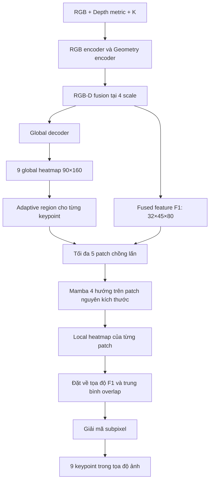

# Kế hoạch bàn giao: RGB-D 4-scale và adaptive local Mamba cho keypoint

## 1. Mục tiêu và các quyết định đã chốt

Mở rộng pipeline hiện tại thành:



Các quyết định bắt buộc:

- Global giữ kiến trúc decoder hiện tại, nhận thêm hai scale.
- Local chỉ lấy feature từ `F1`, đã fusion RGB-D.
- Region và patch thay đổi kích thước theo từng ảnh/keypoint; crop trực tiếp, không resize hoặc dùng ROIAlign kích thước cố định.
- Một selective SSM dùng chung trọng số giữa bốn hướng, các patch và các keypoint.
- **Tọa độ cuối dùng subpixel quanh peak**, đồng thời lưu argmax để đối chiếu.
- **Phạm vi lần này chỉ gồm keypoint 2D**. PnP và learned uncertainty head nằm ngoài kế hoạch.
- Đây là kế hoạch triển khai; chưa có thay đổi code mô hình.

Cấu hình chuẩn:

| Thành phần | Giá trị |
|---|---|
| Input RGB/depth | `180×320` |
| Backbone indices | `(1,2,3,4)` |
| Fusion channels | `(32,32,32,32)` |
| Global decoder width | `32` |
| Global heatmap | `[B,9,90,160]` |
| Nguồn local | `F1: [B,32,45,80]` |
| Local output sau merge | `[B,9,45,80]` |
| Region threshold | `0.30` |
| Region margin | `0.25` mỗi phía |
| Patch layout | Bốn góc và một giữa |
| Overlap ratio | `0.50` |
| Global SSM | Giữ `state_dim=4`, `expand=1`, `directions=1` |
| Local SSM | `state_dim=16`, bắt buộc 4 hướng |
| Backend ban đầu | `torch` |
| Keypoint embedding | Bật trong cấu hình cuối; có ablation tắt |

## 2. Bố cục code và interface

Tổ chức trong package hiện tại, bổ sung ba module có trách nhiệm riêng:

```text
models/keypoints/
├── model.py                 # Ghép global và local stage
├── regions.py               # MỚI: adaptive region, box mapping, patch layout
├── local_refinement.py      # MỚI: local Mamba, local head, overlap merge
├── local_losses.py          # MỚI: target và loss cho patch
├── heatmaps.py              # Bổ sung masked subpixel decoder
├── experiment.py            # Training phase, config, split, checkpoint
├── outputs.py               # Metrics, artifacts, visualization global/local
└── data.py                  # Tái sử dụng RGB/depth/K, tọa độ và visibility

tests/
├── test_keypoint_regions.py
├── test_local_refinement.py
├── test_local_losses.py
└── test_keypoints.py         # Bổ sung integration và compatibility
```

Tái sử dụng `SimpleSelectiveSSM`, `scan_image` và `merge_image` hiện có. Không viết lại selective scan.

**Interface model**

Giữ `forward(rgb, depth, K)` trả global heatmap như hiện tại. Bổ sung:

```python
def forward_stages(
    self, rgb, depth, K, *, return_patches=False
) -> StageOutput:
    ...
```

`StageOutput` chứa:

- `global_heatmaps`: `[B,9,90,160]`.
- `local`: `LocalRefinementOutput`, hoặc `None` khi local bị tắt.

`LocalRefinementOutput` chứa:

- `heatmaps`: `[B,9,Hf,Wf]`, hữu hạn; vùng không phủ lưu `0`.
- `support`: bool `[B,9,Hf,Wf]`, đánh dấu vùng được patch phủ.
- `coverage`: số patch phủ mỗi vị trí.
- `regions`: các record gồm batch index, keypoint index, box global, box F1 và các patch box.
- `patches`: danh sách prediction có gradient khi `return_patches=True`; mỗi record gồm batch index, keypoint index, box và tensor `[1,1,h,w]`.

CLI mới gọi `forward_stages`. Mỗi lần gọi chỉ chạy encoder và fusion một lần.

Luồng ghép model:

```python
rgb_features = self.rgb_encoder(rgb)
geo_features = self.geometry_encoder(depth, K)
fused, _ = self.fusion(rgb_features, geo_features)

global_maps = self.head(
    self.decoder(fused, tuple(self.config["heatmap_size"]))
)

local_result = None
if self.local_enabled:
    local_result = self.local_refinement(
        global_maps.detach(),
        fused[0],
        return_patches=return_patches,
    )

return StageOutput(global_maps, local_result)
```

Chỉ detach heatmap dùng tạo region. Trong joint training, giữ gradient qua `fused[0]`.

## 3. Thuật toán cần triển khai

### 3.1. Mở rộng fusion lên bốn scale

Đặt `out_indices=(1,2,3,4)` trực tiếp khi khởi tạo hai encoder. Không lấy bốn output rồi tiếp tục slice `[1:5]`.

Các shape đã đối chiếu với backbone:

| Scale | RGB channels | Geometry channels | Fused output |
|---|---:|---:|---|
| Stride 4 | 256 | 48 | `[B,32,45,80]` |
| Stride 8 | 512 | 96 | `[B,32,23,40]` |
| Stride 16 | 1024 | 128 | `[B,32,12,20]` |
| Stride 32 | 2048 | 192 | `[B,32,6,10]` |

`MultiScaleRGBDCompensation` đã sở hữu projection RGB/geometry. Dùng các projection này; không chèn thêm `GeometryProjector` trước wrapper.

Global decoder tiếp tục:

```text
Projection từng scale
→ resize về 90×160
→ mean bốn scale
→ hai block Conv/GN/GELU
→ head 32→9
```

Bổ sung kiểm tra số feature khớp số projection để tránh `zip()` bỏ qua feature. Số scale được kiểm tra theo config, vẫn cho phép baseline hai scale.

### 3.2. Tạo adaptive region

Các hàm trong `regions.py`:

```python
peak_component_region(heatmap, level, margin_ratio) -> Box
scale_box(box, src_hw, dst_hw) -> Box
make_patch_boxes(region, layout, overlap_ratio) -> list[Box]
```

`Box` dùng tọa độ nguyên half-open: `[x1,x2) × [y1,y2)`.

Với từng global heatmap:

1. Detach và chuyển sang float32.
2. Chuẩn hóa min-max riêng heatmap.
3. Tìm argmax; nếu hòa, chọn vị trí đầu tiên theo row-major.
4. Threshold tại `0.30`.
5. Flood-fill **4-connectivity**, lấy component chứa argmax.
6. Lấy bounding box của component.
7. Nới mỗi phía `ceil(width×0.25)` và `ceil(height×0.25)`.
8. Clamp box trong global grid.

Xử lý trường hợp đặc biệt:

- Heatmap hằng hoặc `max-min ≤ 1e-6`: dùng toàn bộ grid làm region.
- Heatmap có NaN/Inf: báo lỗi rõ ràng.
- Nhiều peak tách rời: chỉ lấy component chứa peak cao nhất.
- Box luôn không rỗng.

Chuyển toàn bộ batch heatmap sang CPU một lần để tạo box, tránh đồng bộ GPU cho từng pixel. Có thể dùng NumPy và `deque`, không thêm dependency.

Đây là region dựa trên **connected support**. Độ rộng heatmap chưa được coi là uncertainty đã hiệu chuẩn.

### 3.3. Map region sang F1 và tạo patch

Lấy tỷ lệ từ actual tensor shapes:

```python
sx = Wf / Wh
sy = Hf / Hh
```

Map các cạnh box:

```text
x1_f = floor(x1_h × sx)
y1_f = floor(y1_h × sy)
x2_f = ceil(x2_h × sx)
y2_f = ceil(y2_h × sy)
```

Clamp vào F1 sau khi map.

Với region rộng `W`, cao `H`, overlap `r=0.5`:

\[
p_w=\min(W,\lceil W/(2-r)\rceil),\qquad
p_h=\min(H,\lceil H/(2-r)\rceil).
\]

Tạo các patch tại bốn góc và tâm region. Patch tâm dùng phép `round()` như bản đặc tả đính kèm. Loại box trùng, giữ thứ tự ổn định.

Do đó, mỗi region có **tối đa năm patch**; region nhỏ có thể có ít hơn.

Các patch cùng region có cùng kích thước. Kích thước giữa các region có thể khác nhau.

Crop bằng slicing trực tiếp. Khi batch hóa, chỉ gom patch có cùng `(h,w)`; không padding hoặc resize để ép chúng giống nhau.

### 3.4. Local Mamba bốn hướng

`FourDirectionLocalMamba` nhận `[N,32,h,w]` và thực hiện:

```text
scan_image(x, directions=4)
→ [N,4,32,h*w]
→ gộp N và direction thành batch
→ SimpleSelectiveSSM
→ khôi phục [N,4,32,h*w]
→ merge_image
→ LayerNorm theo channel
→ Conv1×1
→ residual với input
```

Tái sử dụng đúng thứ tự mà `scan_image` và `merge_image` đang quy định. Đây là quét row-major/column-major và các chuỗi đảo chiều, phù hợp các hướng cơ bản trong [source LocalMamba](https://github.com/hunto/LocalMamba/blob/main/classification/lib/models/mamba/multi_mamba.py).

Một local SSM dùng chung cho mọi hướng và patch, độc lập với SSM trong global fusion.

Khi bật keypoint embedding:

```python
x = patch + embedding[keypoint_id][:, :, None, None]
```

Sau local block:

```python
patch_heatmap = Conv2d(32, 1, kernel_size=1)(x)
```

Output giữ nguyên `[N,1,h,w]`. Không thêm spatial convolution stack vào local stage.

Giới hạn số patch trong một lượt xử lý là `8`, theo nhóm cùng shape; giới hạn này chỉ điều khiển bộ nhớ, không đổi kích thước patch.

### 3.5. Merge và giải mã subpixel

Đặt từng patch prediction vào đúng box trên grid F1:

\[
H_k^L(x,y)=
\frac{\sum_j M_j(x,y)H_{k,j}(x,y)}
{\max(1,\sum_j M_j(x,y))}.
\]

Giữ `support = coverage > 0` riêng. Khi tìm peak, loại tuyệt đối các pixel ngoài support; không dựa vào sentinel `-1e4` vì response của mạng chưa bị chặn biên.

Giải mã subpixel dùng phép nội suy parabol trên log-response quanh masked argmax, độc lập từng trục:

\[
\delta=
\frac{1}{2}
\frac{\log h_{-1}-\log h_{+1}}
{\log h_{-1}-2\log h_0+\log h_{+1}}.
\]

Chỉ áp dụng khi ba điểm đều:

- Nằm trong support.
- Có response lớn hơn `1e-6`.
- Cho độ cong âm với độ lớn lớn hơn `1e-6`.
- Cho offset hữu hạn và `|δ|≤0.5`.

Nếu không thỏa, offset của trục đó bằng `0`. Lưu thêm cờ cho biết trục nào đã dùng subpixel.

Stencil ba điểm chỉ phục vụ giải mã tọa độ, không thay đổi crop hoặc sequence Mamba.

Dùng lại `transform_points` để chuyển tọa độ F1 về ảnh:

\[
u=(x+0.5)\frac{W_{\text{image}}}{W_f}-0.5,\qquad
v=(y+0.5)\frac{H_{\text{image}}}{H_f}-0.5.
\]

Xuất cả tọa độ trên ảnh input và ảnh gốc. Với ảnh đầu vào `180×320`, một ô F1 tương ứng 4 pixel; subpixel cho phép tọa độ nằm giữa các ô.

### 3.6. Local target và loss

Tạo target từ annotation, không lấy global prediction làm target.

- Map GT từ ảnh gốc sang F1 bằng `transform_points`.
- Gaussian local mặc định `sigma=1` pixel F1, tương ứng `sigma=2` trên global grid.
- Trừ góc trên trái patch để có tọa độ target trong patch.
- GT nằm ngoài footprint patch: target toàn zero.
- Keypoint không hợp lệ theo visibility/weight hiện tại: bỏ khỏi loss.

Để xử lý đúng biên ảnh, footprint của box trong hệ tọa độ pixel center là:

```text
[x1−0.5, x2−0.5) × [y1−0.5, y2−0.5)
```

Giữ công thức weighting hiện tại:

\[
w=1+(\text{positive\_weight}-1)\,T.
\]

Không đổi thành `1 + positive_weight*T`.

Tính loss theo thứ tự: mean theo pixel của patch → mean các patch của một keypoint → mean các keypoint hợp lệ. Cách này tránh keypoint có nhiều patch hơn nhận trọng số lớn hơn.

Joint loss:

\[
L=L_{\text{global}}+\lambda_{\text{local}}L_{\text{local}},
\qquad \lambda_{\text{local}}=1.
\]

Nếu cả batch không có keypoint hợp lệ, loss trả zero hữu hạn và vẫn nối autograd graph.

## 4. Thứ tự triển khai và huấn luyện

Thực hiện tuần tự; mỗi bước phải có test tương ứng trước khi chuyển sang bước kế tiếp.

| Bước | Công việc | Điều kiện kết thúc |
|---|---|---|
| 1 | Config bốn scale, kiểm tra decoder, giữ compatibility | Đúng bốn fused shape và global output |
| 2 | Region extraction, box mapping, overlapping patches | Test tọa độ, coverage, biên và region biến thiên pass |
| 3 | Local Mamba và patch head | Giữ nguyên shape, đúng bốn hướng, gradient hữu hạn |
| 4 | Overlap merge và subpixel decoder | Merge đúng số học, decode đúng trên Gaussian tổng hợp |
| 5 | Local target/loss và `forward_stages` | Gradient local đi tới F1; global head không nhận gradient qua ROI |
| 6 | Training phase, split, checkpoint, CLI | Train/evaluate/infer và reload hoạt động |
| 7 | Artifacts và visualization | Có thể dựng lại kết quả từ dữ liệu đã lưu |
| 8 | Smoke test, benchmark, ablation | Có báo cáo định lượng cho A0–A4 |

**Dataset và checkpoint**

Dùng các file split hiện có: `80 train / 10 val / 10 test`, không giao nhau.

Checkpoint cũ đã học cả 100 mẫu, vì vậy chỉ dùng để kiểm tra khả năng load. Huấn luyện lại A0 và A1 từ đầu cho so sánh trên split mới.

Checkpoint mới lưu `config_version=2`, config đầy đủ, tên keypoint, split IDs, phase, optimizer, epoch và metric chọn checkpoint.

Giữ load strict cho checkpoint cùng kiến trúc. Chuyển từ A1 sang local stage chỉ cho phép thiếu các tham số thuộc local module; mọi mismatch khác phải báo lỗi. Không dùng `strict=False` để bỏ qua tùy ý.

Config cũ thiếu phần local được hiểu là local tắt. Giữ tên module/tham số global để checkpoint cũ vẫn load được.

**Các phase huấn luyện**

| Phase | Module được học | Loss | Cấu hình khởi đầu |
|---|---|---|---|
| A: global | Encoder, fusion, decoder, global head | Global | Tối đa 200 epoch, LR `3e-4` |
| B: local | Local SSM, local head, embedding nếu bật | Local | Tối đa 50 epoch, LR `3e-4` |
| C: joint | Toàn bộ model | Global + local | Tối đa 50 epoch, LR `1e-4` |

Phase B đóng băng global và đặt các module global ở `eval()` để BatchNorm không cập nhật. Cache F1 và global heatmap trên CPU trong phase này. Hủy cache khi sang phase C.

Defaults chung:

- AdamW, weight decay `1e-4`; tôn trọng `_no_weight_decay` của SSM.
- Gradient clipping `5`.
- `positive_weight=100`.
- Batch size `1`, accumulation `8`.
- Seed `20260922`, float32.
- Evaluate mỗi 5 epoch, gồm epoch đầu và cuối.
- Chọn checkpoint theo validation mean pixel error; hòa thì chọn P95 thấp hơn.
- Early stopping sau 20 epoch không cải thiện ở phase A, 10 epoch ở B/C.
- Tạo optimizer mới khi chuyển phase.

Bổ sung lựa chọn CLI cho phase, local on/off, một/năm patch, embedding, decoder argmax/subpixel và evaluation split. Giữ các lệnh `train`, `evaluate`, `infer`, `visualize`.

**Kiểm tra region trước khi train local**

Đo ROI recall trên validation: GT có nằm trong union patch hay không.

Bắt đầu bằng `level=0.30`, `margin=0.25`. Nếu recall dưới 95%, kiểm tra grid:

```text
level  ∈ {0.15, 0.30, 0.50}
margin ∈ {0.25, 0.50, 1.00}
```

Chọn cấu hình có diện tích region trung bình nhỏ nhất trong các cấu hình đạt recall 95%. Nếu không cấu hình nào đạt, chọn recall cao nhất rồi diện tích nhỏ nhất, ghi rõ hạn chế vào báo cáo. Khóa cùng cấu hình region cho A2–A4.

**Ablation bắt buộc**

| Run | Kiến trúc |
|---|---|
| A0 | Hai scale, global only |
| A1 | Bốn scale, global only |
| A2 | A1 + một patch bằng toàn region + local Mamba, embedding tắt |
| A3 | A1 + tối đa năm patch overlap + local Mamba, embedding tắt |
| A4 | A3 + keypoint embedding |

A2–A4 bắt đầu từ cùng checkpoint A1 và cùng khởi tạo các tham số local dùng chung. Mỗi run có phase B/C riêng.

Báo cáo cả argmax và subpixel cho tất cả run để tách lợi ích của kiến trúc khỏi lợi ích của cách giải mã. Test split chỉ dùng đánh giá cuối sau khi khóa cấu hình.

## 5. Kiểm thử, artifacts và tiêu chí hoàn thành

**Các bài kiểm tra bắt buộc**

- Shape bốn scale chính xác tại input `180×320`; có test kích thước lẻ và grid `23×40`.
- Region phản ứng với Gaussian hẹp/rộng, peak biên, hai peak, heatmap hằng và toàn giá trị âm.
- Box mapping bao phủ đúng vùng, không rỗng và không vượt F1.
- Union patch phủ region; loại đúng patch trùng ở region nhỏ.
- Local input/output giữ cùng kích thước với patch `1×1`, `1×N`, `N×1` và hình chữ nhật.
- Scan/inverse scan đúng từng hướng trên tensor có giá trị phân biệt; không chỉ kiểm tra shape.
- Pixel được phủ một lần giữ nguyên prediction; pixel overlap bằng trung bình chính xác.
- Vùng ngoài support không thể thắng argmax, kể cả toàn bộ prediction hợp lệ đều âm.
- Subpixel khôi phục Gaussian có tâm phân số với sai số dưới `1e-3` pixel F1 khi đủ lân cận; fallback đúng ở biên/đỉnh phẳng.
- Point transform round-trip sai số dưới `1e-5` bằng float64; kiểm tra riêng point-center và box-edge convention.
- Loss tôn trọng visibility, GT ngoài patch, batch không có nhãn và số patch khác nhau.
- Local-only backward tạo gradient hữu hạn, khác zero tại local SSM, F1 và fusion/encoder liên quan; không tạo gradient tại global head qua region generation.
- Reload checkpoint mới tái tạo global/local outputs, support và tọa độ; checkpoint cũ tiếp tục chạy được.
- Toàn bộ test hiện có tiếp tục pass.

**Artifacts mỗi run**

Lưu raw global/local heatmap, support/coverage, region và patch boxes, tọa độ argmax/subpixel, peak response, config và checkpoint.

Visualization đọc các artifact đã lưu, hiển thị ảnh, global peak, adaptive region, patch boxes và refined keypoint. Không chỉnh tọa độ dự đoán bằng GT.

Báo cáo:

- Mean, median, P95 pixel error và lỗi từng keypoint.
- ROI recall.
- Kích thước/diện tích region và patch.
- Số patch thực tế, sequence length trung bình và lớn nhất.
- Tỷ lệ dùng subpixel/fallback.
- Liên hệ giữa diện tích region, peak response và global localization error.
- Runtime/image gồm tạo region, scan và merge; peak VRAM.
- So sánh A0–A4 trên cùng split.

**Tiêu chí bàn giao**

Implementation được coi là hoàn tất khi các test pass, pipeline train/evaluate/infer/reload hoạt động và artifacts tái lập được kết quả.

Hiệu quả nghiên cứu được đánh giá riêng: local refinement chỉ được kết luận cải thiện khi metric holdout tốt hơn A1 với cùng cách giải mã. Nếu không cải thiện, bàn giao số đo và phân tích ROI recall, lượng tử hóa, overlap và runtime; không tự mở rộng sang kiến trúc khác.

Cơ sở đã kiểm tra: backbone trả đúng bốn grid và 10 test keypoint hiện tại đều pass. Runtime/VRAM đầy đủ của kiến trúc mới chưa được xác nhận; model triển khai phải benchmark batch `1` trước các lượt train dài.
